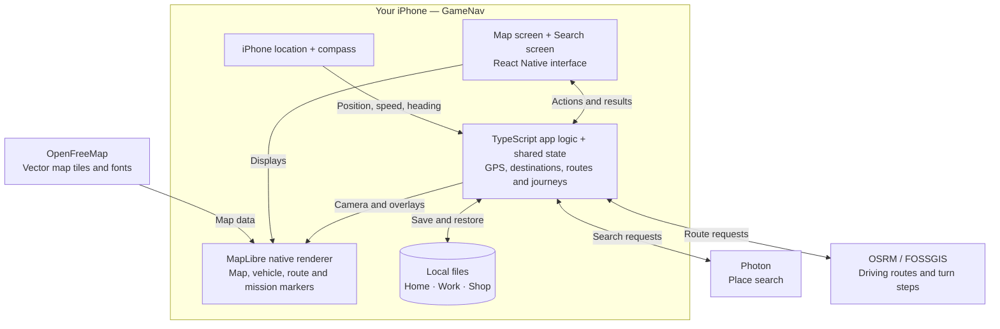
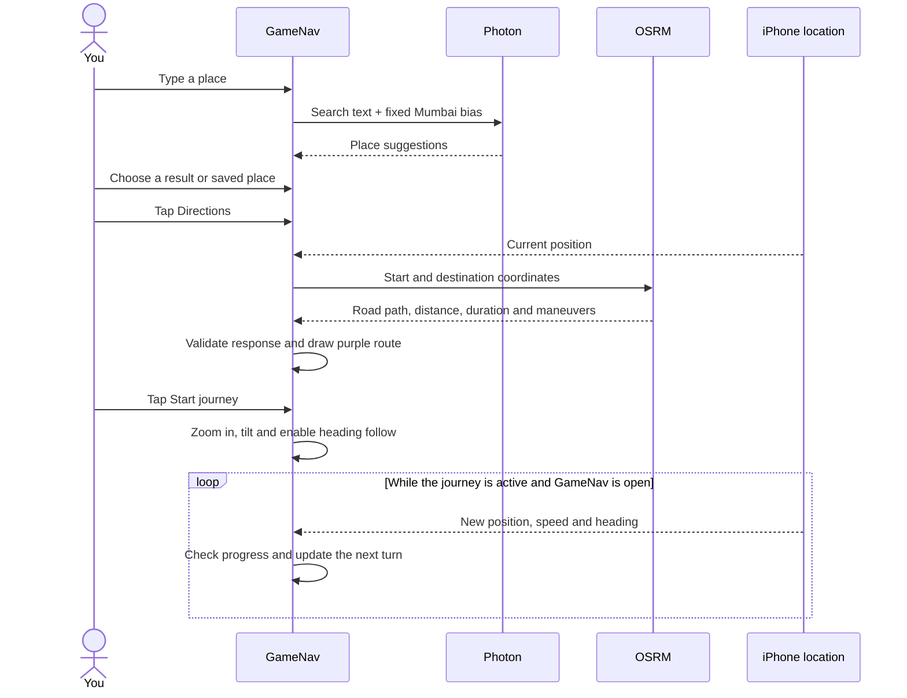
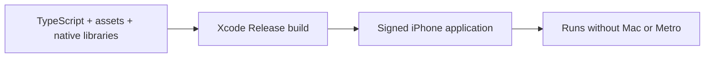

# GameNav

Game-inspired navigation for iPhone, built with Expo SDK 58, React Native, TypeScript, and MapLibre React Native. GameNav combines an original GTA V-inspired grayscale map with real GPS, destination search, driving routes, on-screen maneuvers, and Home/Work/Shop mission markers.

The interface and journey tracking run on the phone. Three online services provide map tiles, place search, and driving routes. There is currently no separate GameNav server, login system, or cloud database.

A **Release build runs without a Mac, USB connection, or Metro server**. Internet is still needed for map downloads, place search, and new routes. Keep GameNav open during a journey.

- [Architecture](#architecture)
- [Journey flow](#journey-flow)
- [Storage and data flow](#storage-and-data-flow)
- [Run the project](#run-the-project)
- [Standalone iPhone build](#standalone-iphone-build)
- [Validation](#validation)
- [Current limitations](#current-limitations)

## Current features

- Classic and GTA V-inspired vector styles using real geographic data, original assets, and configurable map providers.
- Foreground GPS, measured speed, compass/course heading, smooth marker movement, and recenter controls.
- Real search suggestions, destination selection, and long-press map pins.
- Real OSRM road routes with distance, estimated total duration, and on-screen maneuver guidance.
- A closer, tilted, heading-up journey camera with available height-based building extrusions.
- Persistent **H Home**, **W Work**, and **S Shop** mission places, accessible from the map and search.
- Recovery states for permissions, inaccurate/stale GPS, unavailable tiles, network errors, and busy services.

## Architecture

### What runs on the phone and online



### Technology stack

| Technology | Role |
| --- | --- |
| Expo SDK 58 | Project tooling, native configuration, and device modules |
| React Native 0.88 / React 19.3 | Native mobile screens, controls, and UI state |
| TypeScript 6 | App logic and checked data structures |
| Expo Router | Navigation between the map and search screens |
| MapLibre React Native 11.5 | Native vector-map rendering, layers, markers, and camera control |
| Expo Location | Foreground position and compass subscriptions |
| Expo FileSystem | Local saved-place persistence |
| Expo KeepAwake | Prevents display sleep during an active journey |
| Hermes | Runs the app's JavaScript bundle inside the native application |

Expo Router handles **app-screen navigation**. OSRM handles **driving-route calculation**. These are separate responsibilities.

### Screens, shared state, and modules

The root layout wraps the screens in three shared providers:

- **GPSProvider** shares one location feed between screens, avoiding duplicate location subscriptions.
- **DestinationProvider** holds the current destination and its revision. Changing or clearing it invalidates the old route.
- **SavedPlacesProvider** loads, saves, and shares Home, Work, and Shop assignments.

Route-request state and active-journey state are managed by hooks in the map screen. React state and Context are used directly; there is no external state-management service.

| Area | Responsibility | Main source |
| --- | --- | --- |
| App entry | Providers, screen stack, and status bar | [`src/app/_layout.tsx`](src/app/_layout.tsx) |
| Map screen | Map, controls, destinations, overlays, and camera | [`src/screens/CityScreen.tsx`](src/screens/CityScreen.tsx) |
| Search screen | Suggestions, saved shortcuts, and place assignment | [`src/screens/SearchScreen.tsx`](src/screens/SearchScreen.tsx) |
| GPS | Permissions, subscriptions, heading, freshness, and recovery | [`src/hooks/useGPS.ts`](src/hooks/useGPS.ts) |
| Map styling | Classic/GTA V colors, roads, labels, and buildings | [`src/maps/style.ts`](src/maps/style.ts) |
| Search client | Photon requests, validation, deduplication, caching, and cancellation | [`src/search/places.ts`](src/search/places.ts) |
| Route client | OSRM requests and validated route/maneuver data | [`src/routing/routes.ts`](src/routing/routes.ts) |
| Journey engine | GPS progress, next maneuver, remaining distance, and completion | [`src/routing/journey.ts`](src/routing/journey.ts) |
| Journey state | Starts, updates, and ends the current journey | [`src/routing/useJourney.ts`](src/routing/useJourney.ts) |
| Saved places | Storage adapter and shared saved-place state | [`src/saved/SavedPlacesProvider.tsx`](src/saved/SavedPlacesProvider.tsx) |
| Saved-place store | Data validation and serialized persistence operations | [`src/saved/places.ts`](src/saved/places.ts) |
| UI components | Destination cards, turn banners, controls, and mission badges | [`src/components/`](src/components/) |

### Map rendering

OpenFreeMap supplies vector tiles: small geographic data sections containing roads, water, land, and buildings. Our style controls how those features appear. MapLibre combines them with the returned driving-route geometry, position arrow, destination pin, and mission badges.

The GTA V-inspired appearance comes from our own style definitions and original assets. No game map textures, logos, icons, or fonts are copied. No MapLibre demonstration tiles are used.

Building extrusions use supplied `building.render_height` and `render_min_height` values above zoom 15, respecting `hide_3d`. Buildings without supplied heights remain flat.

**Start journey** changes the camera to zoom 17.2, a 55-degree tilt, and heading-up follow. The vehicle is lower in the unobscured viewport to expose more road ahead. Available building extrusions are enabled. **Overview** shows the flat route; the GPS control restores the journey perspective. Dragging suspends follow. End journey restores the browsing view, and Reduce Motion removes camera transition animation.

## Journey flow



OSRM calculates the road route. GameNav then tracks progress along that returned route locally; GPS updates do not automatically send new routing requests.

The route parser validates geometry, estimates, road endpoints, and maneuver continuity. The journey engine checks GPS freshness, accuracy, direction, plausible progress, and ambiguous overlapping geometry before showing the next instruction. Weak/stale GPS or an uncertain/off-route position pauses prompts and remaining distance. Recalculation is manual and available when stopped.

Starting requires a fresh fix accurate to 35 meters or better, a stopped vehicle, and a route calculated within five minutes whose requested start remains within 150 meters. Completion requires three distinct accurate stopped fixes near the driving-route endpoint. Road endpoints may differ from the destination pin: access paths and building entrances are not included, and the app reports **Driving route complete** rather than guaranteeing arrival at an entrance.

The preview duration is an approximate total at calculation, not a live remaining ETA or a traffic-aware estimate. The vehicle marker interpolates between GPS updates; there is no full road-network snapping service or simulated driving.

### Mission places

Search shows **H Home**, **W Work**, and **S Shop** below the input. Tap an empty shortcut, then select a search result or use your current location with accurate GPS. Alternatively, select a destination or hold the map to drop a pin, tap **☆** on its card, and choose a saved-place category.

Tap a saved map badge or search shortcut, then **Directions → Start journey**. Selecting a shortcut alone does not request a route. Hold a search shortcut to change/remove its place, or use the saved letter button on its destination card. Replacing an occupied category requires confirmation. Setup actions hide or disable while moving, while End journey remains available.

## Storage and data flow

| Information | Storage | Survives app restart? |
| --- | --- | --- |
| Home, Work, Shop | JSON files in the app document directory | Yes |
| Selected destination, current route, active journey | App memory | No |
| Search and route caches | Temporary memory | No |
| Theme and camera choices | Screen state | No |

Saved-place operations are serialized so rapid edits cannot overwrite newer saves. Replacements are staged, a validated previous copy is retained for interrupted-write recovery, and failed writes do not report success. These assignments survive process restarts and in-place app updates. Uninstalling the app removes its app data. Normal device backup behavior may apply; there is no GameNav account synchronization.

| Online service | Data sent or requested |
| --- | --- |
| OpenFreeMap | Tiles for the visible map area and label fonts; tile requests reveal the requested region |
| Photon | Search text and a fixed public Mumbai bias; no device GPS is attached |
| OSRM / FOSSGIS | Start and destination coordinates when Directions or Recalculate is requested |

The saved-place feature does not upload assignments. Requesting directions to a saved place sends that place's coordinates as the route destination. There is no GameNav cloud database.

Search starts after three characters and a 600 ms pause; keyboard submit runs immediately. The client caches up to 40 queries for ten minutes. Route responses are cached up to eight entries for five minutes. Both clients serialize requests at 1.5-second intervals, cancel stale work, and honor service cooldowns. Search has a ten-second timeout; routing has a fifteen-second timeout.

## Providers and configuration

The defaults work without an API key:

- [OpenFreeMap](https://openfreemap.org/quick_start/) for vector tiles and glyphs.
- [Photon](https://photon.komoot.io/) for OpenStreetMap-based place search.
- [FOSSGIS / OSRM](https://routing.openstreetmap.de/about.html) for car routes and maneuvers.

Public search/routing hosts are shared services for modest development use and have no availability guarantee. Search accuracy depends on provider coverage. Configure supported hosted or self-hosted services before wider deployment.

Copy [`.env.example`](.env.example) to `.env.local` to configure providers. Alternative tiles must use the OpenMapTiles schema expected by [`src/maps/style.ts`](src/maps/style.ts), or the style must be adapted. Search and routing replacements must expose compatible HTTPS APIs.

`EXPO_PUBLIC_*` values are embedded in the app bundle. Use only client-safe public configuration, never private server keys. Restart Metro for development changes, or rebuild/reinstall a Release app to embed updated configuration. Local environment files and generated native/build output are ignored by Git.

### Attribution

Source attribution metadata is retained in the map style. Public/shared builds display map and route credits. The private personal-device presentation uses ignored `.env.local` configuration (`EXPO_PUBLIC_PERSONAL_BUILD=1`) to hide the visible credit strip while keeping **Map options → About map data** and routing information under Details. The example configuration defaults this flag to 0. Review the chosen providers' licence and hosting terms before distribution; personal presentation settings should not be assumed to waive separate provider conditions.

## Run the project

Run from the repository root. The nested `gamenav/` directory is an unrelated starter and is ignored.

```sh
npm ci
npx expo start --dev-client
```

Open an installed development client and connect to Metro. The phone and Mac must be able to reach each other. **Expo Go cannot load MapLibre's native module.** For a standalone installation, use the Release workflow below.

Expo Router routes live in `src/app/`; screen implementations, components, hooks, clients, and utilities live outside that directory. Native configuration is maintained in [`app.json`](app.json) and config plugins. The ignored `ios/` and `android/` projects are generated; do not hand-maintain them as the source of configuration.

## Standalone iPhone build



The Release build embeds its JavaScript/Hermes bundle and assets. Metro serves code during development; it is not required by the installed Release app. Xcode builds and signs the app but does not calculate journeys while the phone is being used.

### Free Apple Account workflow

1. Sign in to your Apple Account in **Xcode → Settings → Apple Accounts**. The current project uses a Personal Team; another developer should configure their own team in `app.json`.
2. Connect and unlock the iPhone, trust the Mac, and enable Developer Mode on the phone.
3. Install dependencies, then build and choose the connected physical device:

   ```sh
   npm ci
   npm run build:ios:standalone
   ```

   This script runs `expo run:ios --device --configuration Release`. It generates the native iOS project when needed and builds the app using the project's native configuration.

4. Open GameNav directly from its iPhone icon. Allow precise location while using the app.

The configured bundle identifier is `com.abhishekchoudhary.gamenav`. In-place installation with the same identifier retains app data. Native dependency/configuration changes require a new native build. JavaScript-only changes can reload through Metro in a development client; a standalone Release app needs rebuilding/reinstalling to receive them in the current workflow.

For the direct Xcode workflow, after the native workspace and CocoaPods dependencies have been generated:

```sh
pod install --project-directory=ios
xcodebuild -workspace ios/GameNav.xcworkspace -scheme GameNav \
  -configuration Release -destination 'generic/platform=iOS' \
  -derivedDataPath .expo/ios-build \
  -allowProvisioningUpdates -allowProvisioningDeviceRegistration build
codesign --verify --deep --strict \
  .expo/ios-build/Build/Products/Release-iphoneos/GameNav.app
xcrun devicectl device install app --device <YOUR_DEVICE_UDID> \
  .expo/ios-build/Build/Products/Release-iphoneos/GameNav.app
xcrun devicectl device process launch --device <YOUR_DEVICE_UDID> \
  com.abhishekchoudhary.gamenav
```

[Apple Personal Team provisioning profiles expire seven days after issuance](https://developer.apple.com/help/account/basics/about-your-developer-account/), requiring rebuilding and reinstalling. Reusing an existing profile does not restart its expiry. The profile in the last verified installation expires **7 November 2026 at 01:28 AM IST**. Disconnecting USB does not affect the app; network access is still needed for online services.

### Optional EAS cloud builds

[`eas.json`](eas.json) includes development-device and simulator profiles. The current verified workflow is local Xcode signing. Cloud device distribution requires appropriate Apple signing; TestFlight/App Store distribution requires Apple Developer Program membership. No paid enrollment is necessary for the local Personal Team workflow above.

## Validation

```sh
npx expo lint
npx tsc --noEmit
npm test
```

The 49 Node tests use built-in TypeScript stripping (Node 22.18+ or 24+) and cover GPS validity/speed/heading, both map themes in 2D/3D, search requests and typeahead, routing/maneuver validation, journey progress and recovery, and saved-place persistence/concurrency/failure handling. These tests do not replace physical road testing.

Additional diagnostics when changing dependencies or native configuration:

```sh
npx expo-doctor
npx expo export --platform ios --output-dir dist/ios-check
```

The export checks the JavaScript bundle and assets; it does not compile or sign the native iOS app.

### Recorded physical-device checks

On 1 November 2026, the standalone Release app was built, passed strict/deep signature verification, and ran on a physical iPhone 14 with Metro stopped. The real vector map, GPS marker, road-route preview, maneuver banner, remaining-distance card, and mission shortcuts were checked. The user confirmed that saving places and the tilted journey view worked. A saved Home marker reappeared after terminating and relaunching the app, verifying persistence across a real process restart.

Maneuver advancement while actually travelling, off-route recovery, arrival, marker taps, pin saving, editing/removal, and accessibility edge cases remain additional manual acceptance checks. No driving was simulated in the installed app, and no private saved-place coordinates or device screenshots are stored in this repository.

## Current limitations

- No live traffic, traffic-aware arrival ETA, spoken guidance, automatic rerouting, background navigation, speed-limit detection, or offline map downloads.
- Foreground GPS subscriptions pause when the app goes into the background.
- Journey position checks use local route geometry; they are not a full road-network map-matching system.
- Search can miss businesses and addresses absent from the provider's data. Dropped pins provide a manual destination option.
- Road access offsets and building entrances are not included in the driving route.
- Current on-device validation targets iPhone; Android native execution has not been verified.

Use a passenger for setup and road testing. Keep attention on the road rather than interacting with the app while driving.
